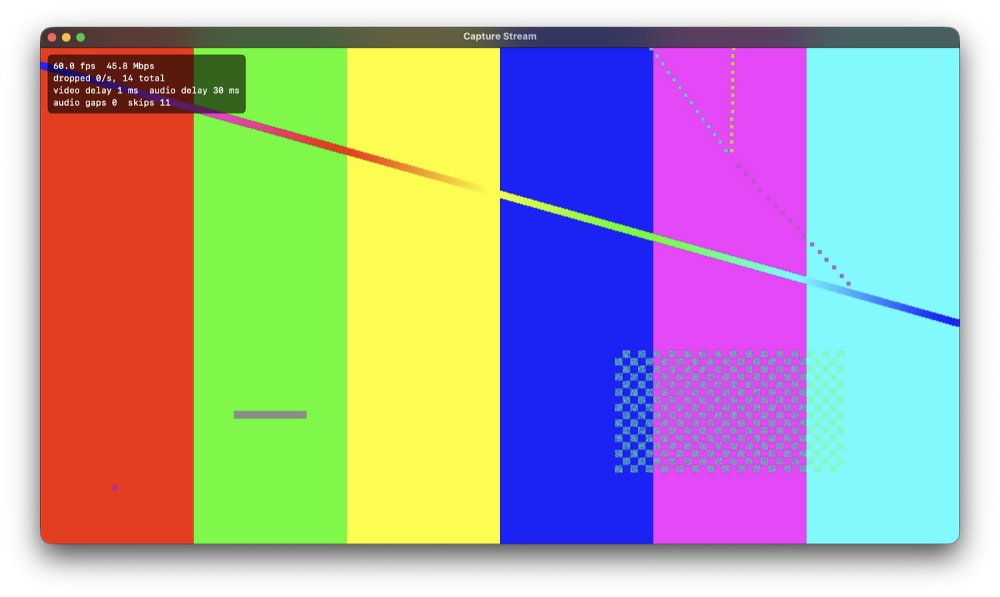
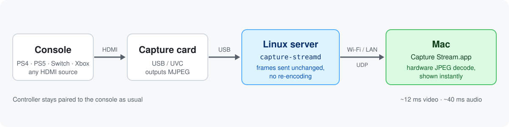
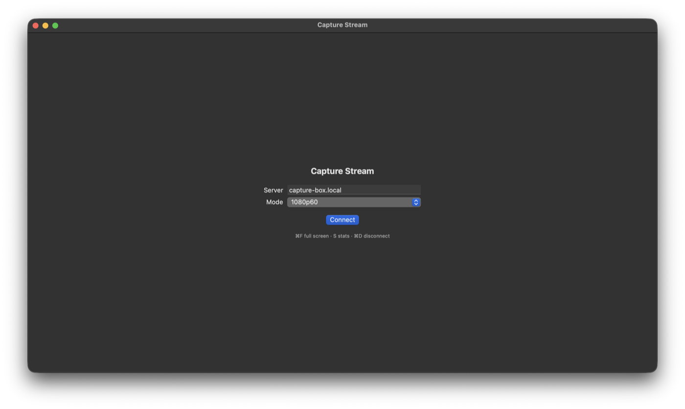

# capture-stream — low-latency HDMI capture card streaming to your Mac

**Stream a PS4, PS5, Nintendo Switch, Xbox or any HDMI source from a USB capture card on a Linux box to
a native macOS app, with about 12 ms of video delay.** Play from the couch or bed while the console stays
by the TV. Your controller stays connected to the console; only picture and sound travel to the Mac.

[**⬇ Download the Mac app**](https://github.com/dylenq/capture-stream/releases/latest) ·
[Website](https://dylenq.github.io/capture-stream/) ·
[Server setup](#server-setup) ·
[Try it without a capture card](#try-it-without-a-capture-card) ·
[FAQ](#faq)





## Why capture-stream?

Game-streaming tools like Sunshine + Moonlight or Steam Link expect a PC running the game. With a capture
card in the middle, they end up decoding the card's video, drawing it on a screen, grabbing that screen
and encoding it again. Every step adds delay and timing jitter.

Most USB capture cards already send compressed **MJPEG** frames. capture-stream forwards those frames
**unchanged** and decodes them only once, on the Mac, with Apple's hardware JPEG decoder.

## Features

- **MJPEG passthrough**: no re-encoding on the server, about 30% of one CPU core even on an old i5.
- **Shown the moment it's decoded**: no playback clock and no frame queue, so delay can't build up.
- **Whole frames only**: a frame with a lost packet is dropped, never shown half-broken.
- **Audio in sync**: raw PCM with a ~20 ms jitter buffer that skips ahead if it ever holds more than
  60 ms, so sound never drifts behind the picture.
- **720p60, 1080p30 and 1080p60** modes, plus your own in the config.
- **Live stats** overlay (press `S`): fps, Mbps, dropped frames, video and audio delay.
- **Native Mac app** (SwiftUI, Apple Silicon): full screen, remembers your server, no extra software.
- **Always-on Linux service**: starts at boot as a systemd user service, streams only while the app is
  connected, no root needed.
- **Demo mode** to try everything without a capture card.
- Open source, MIT licensed, Python standard library on the server and no dependencies on the Mac.

## How fast is it?

Measured on a 2017 Intel i5 server with a MacroSilicon MS2109 USB capture card, streaming to an Apple
Silicon MacBook over 5 GHz Wi-Fi:

| | 720p60 | 1080p60 |
|---|---|---|
| video delay, server reads frame → decoded on the Mac | ~12 ms | 9–15 ms |
| audio delay, server reads samples → out of the speakers | ~35–50 ms | 45–62 ms |
| dropped frames | 0 | 0 |
| bandwidth | 35–55 Mbps | 70–145 Mbps |

These figures don't include the capture card's own delay (typically 1–3 frames) or your display.

The trade-off is bandwidth. MJPEG is compressed frame by frame, so the rate depends on what's on screen:

| mode | bandwidth | notes |
|---|---|---|
| 720p60 | 35–55 Mbps | the smoothest choice on most USB 2.0 cards |
| 1080p30 | 45–60 Mbps | sharper, half the motion smoothness |
| 1080p60 | 70–145 Mbps (~100 average) | sharpest; USB 2.0 cards may deliver a bit under 60 fps |

A wired server and a good 5 GHz connection on the Mac are recommended, especially for 1080p60.

## Download and install the Mac app

1. Download `Capture-Stream-<version>-macOS-arm64.zip` from the
   [latest release](https://github.com/dylenq/capture-stream/releases/latest) and unzip it.
2. Move **Capture Stream.app** to your Applications folder.
3. The app isn't notarised by Apple, so macOS blocks it the first time. Open it once, then go to
   **System Settings → Privacy & Security** and click **Open Anyway**. Or run:
   ```bash
   xattr -dr com.apple.quarantine "/Applications/Capture Stream.app"
   ```
4. Enter your server's hostname or IP, pick a mode and press **Connect**. Allow local-network access, and
   incoming connections if the firewall asks.



| key | action |
|---|---|
| `⌘F` / double-click | full screen |
| `Esc` | leave full screen |
| `S` | stats overlay |
| `⌘D` | disconnect |

Command-line options: `--connect <host> [--mode 720p60]` connects on launch, `--show-stats` turns the
overlay on, and `--log-stats` prints the stats line every second.

The app listens on UDP ports 47101 (video) and 47102 (audio).

### Build it yourself

Requires macOS 14+ on Apple Silicon and the Xcode command-line tools.

```bash
cd client && ./make-app.sh
open "build/Capture Stream.app"
```

## Server setup

**Requirements:** Linux with systemd, Python 3.11+, ffmpeg (with v4l2 and PulseAudio input), PipeWire or
PulseAudio, and a UVC capture card that outputs MJPEG.

1. Install ffmpeg (`sudo apt install ffmpeg` on Debian/Ubuntu) and check the card:
   ```bash
   v4l2-ctl --list-devices                    # find the card, e.g. /dev/video0
   v4l2-ctl -d /dev/video0 --list-formats-ext # MJPEG sizes and frame rates
   pactl list short sources                   # the card's audio input
   ```
2. Install the service (no root needed):
   ```bash
   cd server && ./install.sh
   ```
3. Edit `~/.config/capture-stream/config.toml`: set `video_device`, `audio_source` and the modes your
   card supports, then `systemctl --user restart capture-streamd`.
4. To keep it running while you're logged out: `sudo loginctl enable-linger $USER`.

Logs: `journalctl --user -u capture-streamd -f`

### Config

| key | default | meaning |
|---|---|---|
| `listen`, `control_port` | `0.0.0.0`, `47100` | where the app connects (TCP) |
| `source` | `card` | `card`, or `demo` for a generated test pattern and tone |
| `video_device` | `/dev/video0` | V4L2 capture device |
| `audio_source` | `default` | PulseAudio/PipeWire source name |
| `default_mode` | `720p60` | mode used if the app doesn't pick one |
| `pre_start`, `post_stop` | empty | shell commands run before streaming starts / after it stops, e.g. to free the card from another program |
| `[modes.NAME]` | `720p60`, `1080p30`, `1080p60` | `width`, `height`, `fps` offered to the app |

## Try it without a capture card

The server has a demo source that streams a test pattern and a tone. It runs anywhere ffmpeg does,
including on the Mac itself:

```bash
python3 server/capture-streamd.py --demo
```

Then connect the app to `localhost` (or the machine's IP). To check a server from the command line without
the app:

```bash
python3 tools/probe.py <server> --mode 720p60
```

It connects, receives for 10 s and reports complete/incomplete frames, frame rate, bandwidth, audio gaps
and delay.

## FAQ

### Can I stream my PS4 or PS5 to a MacBook with a capture card?
Yes. Connect the console's HDMI output to a USB capture card on a Linux machine (a home server or mini
PC), run `capture-streamd`, and connect with the Mac app. Turn HDCP off on the console first (PS4: *Settings → System → Enable HDCP*; PS5:
*Settings → System → HDMI → Enable HDCP*), or the card captures nothing.

### Is this a Moonlight or Sunshine alternative?
For capture cards, yes. Sunshine/Moonlight stream a computer's own screen; they can show a capture card
only by displaying it and re-encoding it, which adds delay. capture-stream sends the card's frames
straight to the Mac. If you're streaming games running *on* a PC, use Sunshine/Moonlight.

### How is this different from PS Remote Play?
Remote Play streams from the console itself and sends your controller input over the network.
capture-stream works with any HDMI device, doesn't need an account or the console's cooperation, and
your controller stays connected to the console directly.

### Which capture cards work?
Any UVC (driver-free) USB capture card that outputs MJPEG, which covers most cheap HDMI-to-USB cards.
Cards with the MacroSilicon MS2109 chip are USB 2.0: they do a true 60 fps at 720p and about 57 fps at
1080p. Run `lsusb -t`: `480M` means USB 2.0, `5000M` means USB 3.0.

### Does it work on Windows or iOS?
Not yet. The server runs on Linux; the client is macOS-only (Apple Silicon). The protocol is simple and
documented below, so other clients are possible.

### Can I stream over the internet?
It's designed for a home network. MJPEG needs 35–145 Mbps, more than most internet uploads, and the
server has no authentication, so don't expose its ports to the internet.

## Troubleshooting

- **Black screen / "no frames from the capture card"**: is the source on, and is HDCP off? Cheap cards also
  sometimes freeze after a mode change; unplug and replug the card's USB cable.
- **1080p60 runs below 60 fps or drops frames**: many USB 2.0 cards deliver ~57 fps at 1080p60, and it
  needs about twice the bandwidth of 1080p30. 720p60 is usually the smoothest true-60 mode.
- **Dropped frames on Wi-Fi**: the stats overlay shows them. Move closer to the access point, use 5 GHz,
  or pick a lower mode.
- **The picture never appears but stats show data arriving**: some cards' JPEGs aren't accepted by the
  hardware decoder; the app switches to software decoding automatically after a few frames.

## How it works

- **Control:** TCP, one JSON object per line. The app sends `hello` (mode, UDP ports) and `ping` every
  second; the server answers `ok`, `pong` (used for the clock offset behind the delay figures) and
  `error`. Streaming stops when the connection closes or pings stop for 3 s.
- **Video:** ffmpeg reads the card's JPEGs with `-c:v copy`. The server splits them into ≤1400-byte UDP
  packets with a 20-byte header (frame id, packet index/count, capture time).
- **Audio:** the same ffmpeg sends 48 kHz stereo 16-bit PCM in 5 ms UDP packets with a 16-byte header
  (sequence number, capture time).

See the header of [`server/capture-streamd.py`](server/capture-streamd.py) for the exact byte layout.

## License

[MIT](LICENSE). Not affiliated with Sony, Nintendo, Microsoft or Apple; product names are used only to
describe compatibility.
